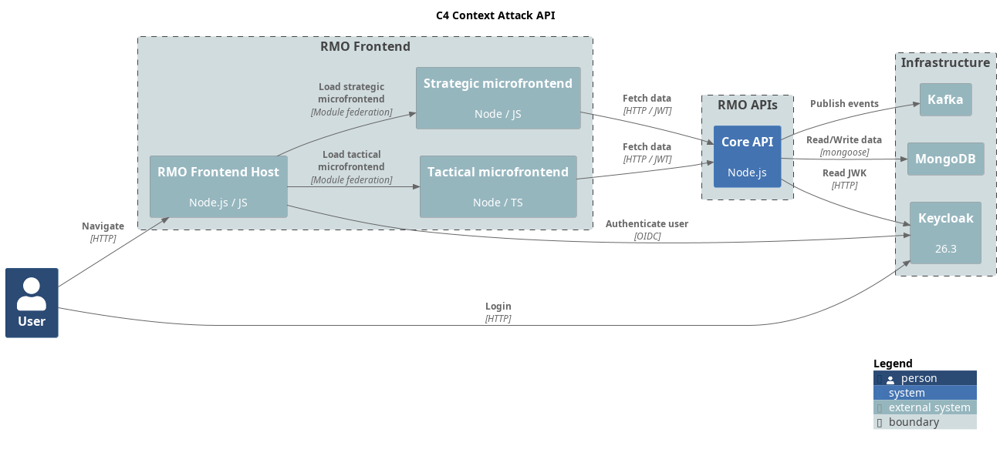
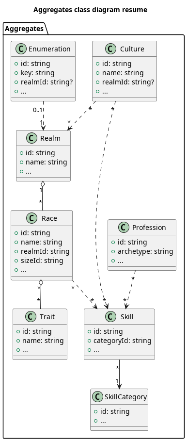

= RMU Engine Core API
:linkattrs:
:icons: font

image:https://img.shields.io/badge/license-GPL3.0-green.svg[License,link="https://www.gnu.org/licenses/gpl-3.0.html"]
image:https://img.shields.io/badge/rolemaster-rmu-green.svg[Rolemaster,link="http://ironcrown.co.uk/unified-rolemaster/"]

++++
<a href="https://www.postman.com/labcabrera/workspace/rmu-engine/collection/5547717-39d04dee-7325-4251-86e5-e1f250cd99f2?action=share&creator=5547717&active-environment=5547717-f0da278a-5cc7-4d6c-8a82-8739ae0d1b0b" target="_blank">
  
</a>
++++

REST API for Rolemaster Unified Core services.

This project is part of RMU Online: https://github.com/labcabrera/rmu-platform

WARNING: *This application is an independent project developed by fans of Rolemaster Unified. It is not affiliated with, endorsed by, or licensed by Iron Crown Enterprises (ICE), the owners of the Rolemaster intellectual property.*
*All Rolemaster trademarks, game systems, and materials are the property of Iron Crown Enterprises. This software is provided for personal, non-commercial use only. If you enjoy Rolemaster, please support the official publications and content from ICE.*

== Overview

This API exposes endpoints to manage the common entities of the RMU ecosystem: realms, races, professions, cultures,
skills (and categories), traits, enumerations and other related entities.



The main aggregates are:



== Getting started

=== Requirements

- Node.js 24 (`.nvmrc`; `nvm use`).
- pnpm 10, pinned by the `packageManager` field of `package.json`. `corepack enable` installs that exact version.
- Docker (20.10+) for the infrastructure and the image.

=== Infrastructure

The API connects to MongoDB, Kafka and the Keycloak JWKS at startup. Start them from
https://github.com/labcabrera/rmu-platform[rmu-platform] with `make up-infra` (Compose files in `compose/`).

=== Configuration

Configuration is read from `.env` at the repository root. Copy `.env.example`, which already points to the
infrastructure ports seen from the host, and set `RMU_IAM_CLIENT_SECRET`:

```bash
cp .env.example .env
```

The Joi schema in `src/config/env.schema.ts` fails startup on a missing required variable.

[cols="2,1,3"]
|===
| Variable | Required | Purpose

| `PORT` | no (`3001`) | HTTP port
| `LOG_LEVEL` | no (`info`) | Nest logger level
| `RMU_MONGO_CORE_URI` | yes | MongoDB connection string
| `RMU_IAM_JWK_URI`, `RMU_IAM_ISSUER_URI`, `RMU_IAM_AUDIENCE` | yes | JWT validation
| `RMU_IAM_TOKEN_URI`, `RMU_IAM_CLIENT_ID`, `RMU_IAM_CLIENT_SECRET` | yes | service-account token (client credentials, `TokenService`)
| `RMU_IAM_URI`, `RMU_IAM_REALM` | no (`http://localhost/sso`, `rmu`) | browser-facing OAuth URLs of the Swagger UI (`/api-docs`)
| `RMU_KAFKA_BROKERS`, `RMU_KAFKA_CLIENT_ID` | yes | Kafka connection
| `RMU_KAFKA_DEFAULT_PARTITIONS` | no (`1`) | number of partitions the producer spreads messages over (by key hash)
|===

=== Running locally

```bash
pnpm install
pnpm start:dev       # watch mode on http://localhost:3001, Swagger UI on /api-docs
```

Production build (SWC; `dist/` holds only `.js` and source maps):

```bash
pnpm build
pnpm start:prod
```

== Development

=== Scripts

[cols="1,3"]
|===
| Command | What it does

| `pnpm start:dev` / `pnpm start:debug` | Nest in watch mode (with the inspector for `start:debug`)
| `pnpm build` | SWC build to `dist/`, without type checking
| `pnpm typecheck` | `tsc --noEmit`
| `pnpm lint` / `pnpm lint:fix` | ESLint (typed `typescript-eslint` + Prettier) over `src` and `test`
| `pnpm format` | Prettier over `src` and `test`
| `pnpm test` / `pnpm test:watch` | unit tests (`test/unit`)
| `pnpm test:cov` | unit tests with v8 coverage in `coverage/`
| `pnpm test:e2e` | boots `AppModule` against mongodb-memory-server; Kafka and the JWT guard are replaced
| `pnpm check` | lint + typecheck + unit tests
| `make check` | `pnpm check` plus the e2e tests (what CI runs before the build)
|===

Tests run on Vitest with SWC (`vitest.config.ts`, projects `unit` and `e2e`). The first `test:e2e` run downloads a
`mongod` binary to `~/.cache/mongodb-binaries`.

`scripts/smoke.sh [base-url]` calls one endpoint of every controller of a running API with a service-account token and
fails on any non-2xx answer (default `http://localhost:3001`; through the gateway `http://localhost/api/core`).

pnpm skips the install scripts of `@scarf/scarf`, `@swc/core` and `mongodb-memory-server` (`pnpm.ignoredBuiltDependencies`):
none of them is needed, and mongodb-memory-server downloads `mongod` on first use.

=== Project layout

----
src/
  main.ts                  bootstrap only: pipes, filters, Kafka transport, shutdown hooks
  bootstrap/               logger levels and OpenAPI (Swagger) setup
  config/env.schema.ts     Joi schema of the environment
  modules/<feature>/
    <feature>.module.ts
    domain/                aggregates, value objects, domain services, repository ports
    application/cqrs/      commands, queries and their handlers
    infrastructure/
      db/                  repository adapters (Mongo)
      persistence/models/  Mongoose schemas
      security/            <entity>-guard.adapter.ts (read/write access checks)
      messaging/           Kafka event publishers
    interfaces/http/       controllers
      dto/                 request and response DTOs
  modules/shared/          base repository, RSQL parser, DomainError -> HTTP filter, Kafka producer, health
    infrastructure/security/  JWT strategy and guard, TokenService (client credentials), AuthModule
test/unit/domain/<feature>/  unit tests
test/e2e/                    smoke test of the whole application
----

Conventions:

- The package is ESM (`"type": "module"`). Imports are relative and end in `.js` (`'./races.module.js'`); there is no
  `src/...` alias. `verbatimModuleSyntax` requires `import type` for anything that is only a type, but a class used as a
  constructor parameter must stay a value import, because Nest reads it from the decorator metadata.
- File names are kebab-case (`race-guard.adapter.ts`), with a dotted suffix for the role (`.module`, `.controller`,
  `.dto`, `.handler`, `.repository`).
- A read-only module may skip `domain/` (`character-sizes`).
- The build uses SWC (`nest build`), which compiles file by file and cannot resolve imported type aliases in decorator
  metadata. A property typed with a string union alias (`AccessType`) needs an explicit `type: String` in `@ApiProperty`
  and `@Prop`, and constructor injection must not use a bare `@Inject()` (Nest would read `Function` as the token).
  `pnpm typecheck` runs `tsc --noEmit` separately.

== Docker

`make docker-build` builds `labcabrera/rmu-api-core:latest` and `make docker-run` runs it on the `rmu-network` Docker
network (needs `.env.docker`, copied from `.env.docker.example`). The image (`node:24-bookworm-slim`, pnpm through
corepack) only holds `dist/` and the production dependencies, runs as the `node` user with `NODE_ENV=production` and has
its own `HEALTHCHECK` on `/v1/health`. Run it with `--init` (`init: true` in compose) so `SIGTERM` reaches Node and Nest
closes Kafka and Mongo.

`make docker-push` builds `linux/amd64` and `linux/arm64` without emulation: every `RUN` step happens on the builder's
platform, and `supportedArchitectures` makes pnpm install the optional native binaries of the target platform.

The whole stack (APIs, MFEs, gateway, infrastructure) runs from the Compose files of rmu-platform.

== Releases

`make create-release` runs semantic-release from a clean `develop`: it merges into `master`, derives the version from the
Conventional Commits (force one with `RELEASE_BUMP=patch|minor|major`), tags it without `v`, updates `CHANGELOG.md`, and
bumps `develop` to the next `-SNAPSHOT`. Commit messages are checked by commitlint in a husky hook.

== API template

`rmu-api-core` is the reference for the other NestJS APIs (spec 014). To bring an API to the same platform, copy these
files and adapt names, ports and the Mongo variable:

[cols="1,3"]
|===
| File | What it sets

| `Dockerfile`, `.dockerignore` | `node:24-bookworm-slim`, pnpm through corepack, build and production dependencies on the builder's platform, `node` user, `HEALTHCHECK` on `/v1/health`, `--enable-source-maps`
| `nest-cli.json`, `.swcrc` | SWC builder (`stripLeadingPaths`, decorator metadata, ES modules), no type check during the build
| `tsconfig.json`, `tsconfig.build.json` | `nodenext`, ES2024, `strict`, `verbatimModuleSyntax`, no declarations, build info in `node_modules/.cache`
| `vitest.config.ts` | Vitest + `unplugin-swc`, `unit` and `e2e` projects, v8 coverage
| `eslint.config.mjs` | typed `typescript-eslint`, Prettier, ESM, Vitest globals, `no-unsafe-*` as errors
| `package.json`, `pnpm-lock.yaml` | `"type": "module"`, `engines.node >=24`, `packageManager` (pnpm), `pnpm.ignoredBuiltDependencies`, scripts `build`, `typecheck`, `lint`, `lint:fix`, `test`, `test:cov`, `test:e2e`, `check`, `start:prod`
| `commitlint.config.cjs`, `release.config.cjs` | CommonJS configs in an ESM package
| `.github/workflows/ci.yml` | pnpm install, lint, typecheck, unit, e2e and build on Node 24, plus a `docker build` without push
| `src/main.ts`, `src/bootstrap/`, `src/config/env.schema.ts` | short bootstrap with shutdown hooks, logger levels, OpenAPI and the Joi schema
| `src/modules/shared/infrastructure/security/` | JWT strategy and guard, `TokenService`, `AuthModule`
| `test/e2e/app.e2e-spec.ts`, `scripts/smoke.sh` | smoke test with `mongodb-memory-server`, and the same calls against a running API with a real token
|===

Run the API with `init: true` in compose. The SWC caveats under <<Project layout>> apply to every API: an explicit
`type: String` for string union aliases in `@ApiProperty`/`@Prop`, and no bare `@Inject()`.

== Contributing

If you want to contribute:

- Open an issue describing the change.
- Create a branch with a clear name and a PR with description and tests when applicable.
